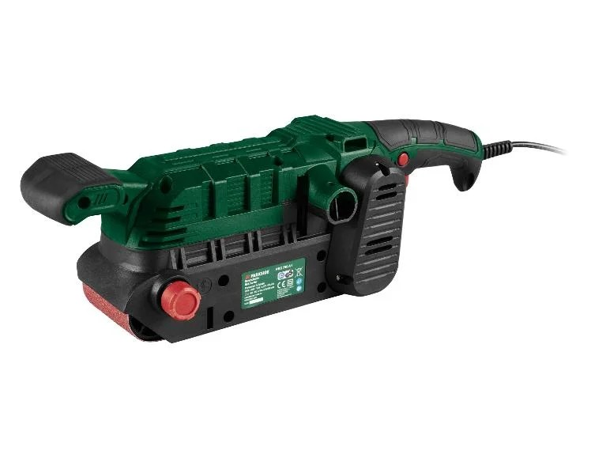

# Ponceuse à bande

Donnée par un adhérent en octobre 2026. Elle se prête comme les autres outils, avec la caution de 50 €.

- Prêtez-la dans sa mallette, avec deux bandes de rechange (grain 80 et grain 120).
- Montrez à l'emprunteur comment changer la bande : le levier est sur le côté gauche.
- Au retour, vérifiez que le sac à poussière est vide.
